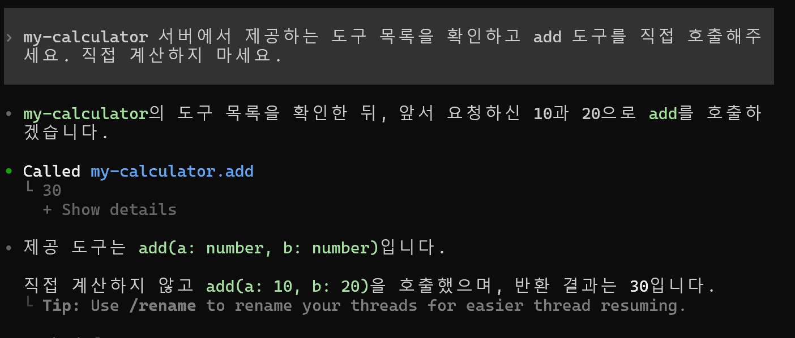

# [CLI 프로그램 개발 방법 요약]


## 1. CLI 프로그램의 기본 구조

CLI(Command Line Interface)는 **사용자가 터미널에 명령어를 입력하면 해당 기능을 실행하는 프로그램**이다.

일반 웹 프로젝트의 Controller처럼 `index.js`가 입력을 받아 적절한 기능을 호출한다.

```text
my-cli/
├── package.json     # CLI 명령어 및 프로젝트 설정
├── index.js         # CLI 진입점, 명령어 처리
└── calculator.js    # 실제 비즈니스 로직
```


## 2. index.js의 역할

**CLI 프로그램의 진입점으로, 터미널 입력을 해석하고 해당 기능을 실행한다.**

```javascript
#!/usr/bin/env node

const { add } = require("./calculator");

// 사용자가 입력한 명령어
const command = process.argv[2];

if (command === "add") {
  const a = Number(process.argv[3]);
  const b = Number(process.argv[4]);

  if (!Number.isFinite(a) || !Number.isFinite(b)) {
    console.error("올바른 숫자를 입력해주세요.");
    process.exit(1);
  }

  console.log(`결과: ${add(a, b)}`);
}
```

- `#!/usr/bin/env node`: Node.js로 실행하도록 지정
- `process.argv`: 터미널에서 전달받은 명령어와 인자
- `console.log()`: 터미널에 결과 출력
- `process.exit(1)`: 오류 발생 시 비정상 종료

**Spring Boot의 Controller와 유사한 역할**이다.


## 3. package.json의 bin과 scripts

```json
{
  "name": "test-cli",
  "version": "1.0.0",
  "bin": {
    "devtool": "./index.js"
  },
  "scripts": {
    "start": "node index.js"
  }
}
```

| 구분 | bin | scripts |
|---|---|---|
| 역할 | CLI 명령어 등록 | npm 실행 명령어 등록 |
| 실행 예시 | `devtool add 10 20` | `npm start` |
| 목적 | 사용자가 직접 CLI 실행 | 개발·빌드·테스트 등의 작업 실행 |

**bin**은 `devtool`이라는 명령어를 `index.js`와 연결한다.

**scripts**는 `npm start`를 실행할 때 `node index.js`를 실행하도록 설정한다.

## 4. 각 파일의 역할

| 파일 | 역할 | 웹 프로젝트 비유 |
|---|---|---|
| `package.json` | npm 패키지 및 실행 설정 | Gradle 설정 파일 |
| `index.js` | 명령어 파싱, 입력 검증, 결과 출력 | Controller |
| `calculator.js` | 실제 계산 기능 구현 | Service |

`calculator.js` 예시:

```javascript
function add(a, b) {
  return a + b;
}

module.exports = { add };
```

기능 로직을 분리하면 CLI뿐 아니라 MCP 서버에서도 동일한 함수를 재사용할 수 있다.


## 5. 프로젝트 생성 및 실행

**① 프로젝트 생성**

```bash
mkdir my-cli
cd my-cli
npm init -y
```

**② 파일 작성**

`index.js`, `calculator.js`를 생성하고 `package.json`에 `bin`을 설정한다.

**③ CLI 실행 권한 부여 및 연결 (Ubuntu)**

```bash
chmod +x index.js
npm link
```

**④ 실행**

```bash
devtool add 10 20
```

출력:

```text
결과: 30
```


## 핵심 정리

```text
사용자: devtool add 10 20
             ↓
package.json의 bin
  → devtool 명령어와 index.js 연결
             ↓
index.js
  → 명령어 해석 및 입력값 검증
             ↓
calculator.js
  → add(10, 20) 실행
             ↓
index.js
  → console.log()으로 결과 출력
             ↓
터미널: 결과 30
```

**CLI 개발의 핵심은 `package.json`에서 실행 명령어를 등록하고, `index.js`에서 사용자 입력을 해석하고, 별도 모듈에서 실제 기능을 수행하도록 역할을 분리하는 것이다.**


## 실행 가능 명령어
```
devtool hello 정민
```
출력: 안녕하세요, 정민님!

```
devtool add 10 20 
```
출력: 계산 결과: 30 


# [Node.js MCP 서버 구현]

## 1. 프로젝트 구조

기존 CLI 프로그램에 MCP 서버를 추가하여 Codex에서도 동일한 계산 기능을 사용할 수 있도록 구현한다.

```text
Test-CLI/
├── package.json       # 기존 CLI 명령어 및 의존성 관리
├── index.js           # 기존 CLI 명령어 처리
├── calculator.js      # 기존 공통 계산 로직
└── mcp-server.js      # MCP 서버 및 도구 등록
```

**CLI:** 사용자 → `index.js` → `calculator.js`

**MCP:** Codex → `mcp-server.js` → `calculator.js`

## 2. MCP SDK 설치

```bash
npm install @modelcontextprotocol/server zod
```

- `@modelcontextprotocol/server`: MCP 서버 구현
- `zod`: 도구 입력값의 타입 검증

## 3. MCP 서버 구현

**calculator.js**

```javascript
function add(a, b) {
    return a + b;
}

module.exports = { add };
```

**mcp-server.js**

```javascript
const { add } = require("./calculator");

async function main() {
    const { McpServer } =
        await import("@modelcontextprotocol/server");
    const { StdioServerTransport } =
        await import("@modelcontextprotocol/server/stdio");
    const z = await import("zod/v4");

    // MCP 서버 생성
    const server = new McpServer({
        name: "my-calculator",
        version: "1.0.0"
    });

    // AI가 사용할 도구 등록
    server.registerTool(
        "add",
        {
            description: "두 숫자를 더합니다.",
            inputSchema: z.object({
                a: z.number(),
                b: z.number()
            })
        },
        async ({ a, b }) => ({
            content: [{
                type: "text",
                text: String(add(a, b))
            }]
        })
    );

    // 표준 입출력 통신 연결
    const transport = new StdioServerTransport();
    await server.connect(transport);
}

main().catch(console.error);
```

| 코드 | 역할 |
|---|---|
| `McpServer` | MCP 서버 생성 |
| `registerTool()` | AI가 호출할 기능 등록 |
| `inputSchema` | 입력 파라미터 정의 |
| `StdioServerTransport` | Codex와 stdin/stdout 통신 |
| `server.connect()` | MCP 통신 시작 |

## 4. MCP 서버 실행 및 Codex 연결

**① 서버 실행 확인**

```bash
node mcp-server.js
```

오류 없이 실행되고 입력을 기다리면 `Ctrl + C`로 종료한다.

**② Codex에 MCP 서버 등록**

```bash
codex mcp add my-calculator -- node /mnt/c/dev/Test-CLI/mcp-server.js
```

**③ 등록 확인 및 테스트**

```bash
codex mcp list
codex
```

Codex에 다음과 같이 요청한다.

> my-calculator의 add 도구를 사용해서 10과 20을 더해줘.

실제 실행 결과:

```text
• Called my-calculator.add
  └ 30
```

## 5. 실행 화면

**MCP 도구 호출 화면**



## 6. 핵심 정리

- **CLI:** 사람이 터미널 명령어로 기능 호출
- **MCP 서버:** Codex가 MCP 도구를 통해 기능 호출
- **공통 로직:** `calculator.js`를 재사용하므로 기능을 중복 구현할 필요가 없음
- **배포:** CLI와 MCP 서버를 하나의 npm 패키지로 제공 가능

**결론:** MCP 서버는 새로운 비즈니스 로직을 만드는 것이 아니라 기존 기능을 AI 에이전트가 호출할 수 있도록 도구로 공개하는 프로그램이다.